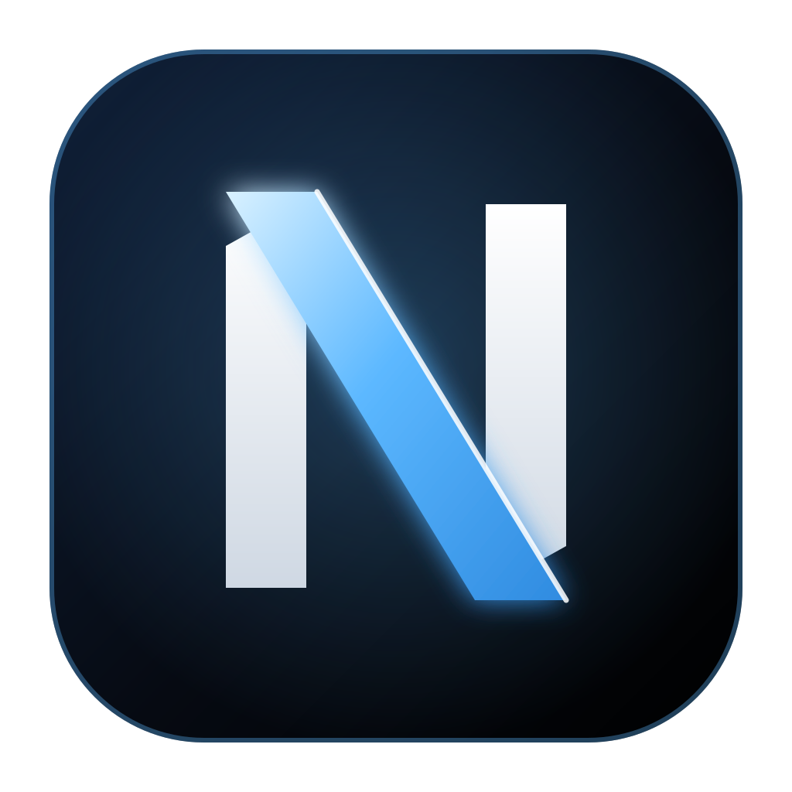

<p align="center"></p>

# NEXORA Studio

**Website and downloads: https://nexora-editor.pages.dev** · [Changelog](CHANGELOG.md) · [Releases](../../releases)

One application, many creative workspaces sharing one project and one asset library.
Start on **Home** (create a project, pick a template, or reopen one from the Projects grid). Inside a project, a vertical **mode rail** switches between **Edit**, **Motion**, **VFX** and **Design** on the same project; every project autosaves to a local library.
Every mode on the rail works on the same project: Edit, Motion, VFX, Design, Audio, Vector, 3D, Gaming and AI — see [docs/STATUS.md](docs/STATUS.md) for exactly what works and what does not.

## Download
Get the latest build from **https://nexora-editor.pages.dev** or the [Releases page](../../releases/latest). Windows is the main platform; the macOS and Linux packages are built but not yet tested on real machines. The app is not code-signed yet, so Windows SmartScreen may warn the first time: choose **More info → Run anyway**.

## Build from source
```
git clone <this repository>
cd nexora-studio
powershell -ExecutionPolicy Bypass -File scripts\fetch-vendor.ps1   # FFmpeg + AI models, checksum-verified
npm install
npm start
```
FFmpeg and the on-device AI models are too large for git, so `scripts/fetch-vendor.ps1` downloads them and checks every file against a fixed SHA-256. Online sign-in uses a Google Apps Script backend: copy `electron/gas.config.example.json` to `electron/gas.config.json` with your own deployment URL (setup in [docs/ACCOUNTS.md](docs/ACCOUNTS.md)), or leave it out and the app runs with local accounts only.

The website lives in `site/` and is static HTML, deployable to Cloudflare Pages with no build command and `site` as the output folder.

## Releasing
Versions are **MAJOR.MINOR.PATCH**:
- **PATCH** (1.4.**1**): small fixes, no new features
- **MINOR** (1.**5**.0): an update with new features
- **MAJOR** (**2**.0.0): a revamp of the whole app; this is rare

The first public release is 1.0.0. (The earliest builds on GitHub were numbered 2.0.0–2.3.0; they correspond to 1.0.0–1.3.0.)

Version history lives in `nexora/app/changelog.js` (the app's What's new). Add the new version at the top, set the same version in `package.json`, run `pwsh scripts/changelog.ps1` (writes CHANGELOG.md, RELEASE_NOTES.md and the website copy), commit, then tag `vX.Y.Z`: GitHub Actions tests on Windows, macOS and Linux, builds the four zips with the NEXORA icon and publishes the release.

## License
NEXORA Studio is MIT licensed ([LICENSE](LICENSE)). Bundled components keep their own licenses, listed in [THIRD_PARTY_NOTICES.md](THIRD_PARTY_NOTICES.md); the Windows release includes FFmpeg under GPL v3.

## Run
- **Windows (no install):** unzip `NEXORA-Studio-win-x64.zip` → run `NEXORA Studio.exe`.
- **Linux x64:** unzip `NEXORA-Studio-linux-x64.zip` → `./nexora-studio` (see README-LINUX.txt inside).
- **macOS (Apple silicon / Intel):** unzip `NEXORA-Studio-mac-arm64.zip` or `-mac-x64.zip`; unsigned — follow README-MAC.txt once. (Linux/macOS packages are built but not yet run on real machines.)
- **Installer + portable .exe:** install Node.js 18+, double-click `build-windows.bat` (output in `release/`).
- **Browser:** `powershell -File serve.ps1` → http://localhost:5173 (Chrome/Edge).
- **Tests:** http://localhost:5173/tests/run.html, or Ctrl+K › "Run automated self-tests".

## Highlights
- **Accounts:** e-mail + password, Google, Microsoft, GitHub and single sign-on, authenticator-app 2FA, recovery codes, profiles, a per-account library. Setup: [docs/ACCOUNTS.md](docs/ACCOUNTS.md).
- **AI Editor:** describe an edit and the AI performs it on the real timeline, with one-button undo. Uses your own key: OpenCode Zen (open models such as DeepSeek, GLM, Kimi, Qwen, MiniMax, plus Claude) or Anthropic. The key is checked before it is saved and stored encrypted by the OS, never in project files.
- **Music:** 1,260 original funk, phonk and other tracks made on your computer, Creative Commons search, your own MP3 folders, audio extraction from video, MP3 export, beat-synced cuts.
- **Resolution:** projects and exports up to 8K, with 4K UHD and DCI 4K presets.
- **Image:** layered PSD import/export, real Poisson healing and PatchMatch Content-Aware Fill, floating panels; 29 working tools (selections, brushes, clone/heal/spot-heal, dodge/burn/sponge, blur/sharpen/smudge, liquify, gradient, bucket, pen paths, text, shapes, crop, free/perspective/warp transform); masks, clipping, groups, 14 non-destructive adjustment layers, layer effects, worker-based filters, content-aware fill; PNG/JPEG/WebP/BMP/TIFF/SVG/.nxi; 11 layered templates (YouTube, gaming, Minecraft, banner, logo…).
- **Edit:** multitrack timeline, keyframes + graph editor, expressions, parenting, precomps, 3D tilt, tracking, captions, exact-frame export.
- **Pro editing:** J/K/L shuttle, In/Out marks, insert/overwrite, lift/extract, ripple/roll/slip trims, edit-point navigation; waveform, RGB parade, vectorscope and histogram scopes; `.cube` LUT import and filter → `.cube` bake; render cache (Enter) for real-time playback of heavy effects.
- **Pro delivery (Windows desktop, bundled FFmpeg):** ProRes 422 / HQ / 4444 with alpha, DNxHR, CineForm, PNG/TIFF sequences, WAV stems; H.264 / HEVC / HEVC 10-bit / VP9 / AV1 in hardware or software; 23.976–60 fps, In–Out range. Footage Chromium cannot play (ProRes, DNxHR, MXF, AVI, MTS…) imports through automatic optimized media.
- **Shared project:** `.nexora` schema v3 (migrates v1/v2), linked assets (Image/Motion/VFX → Edit update live), usage tracking, projects library with autosave and thumbnails.
- **Performance:** WebGL2 GPU effects (≈12× faster on heavy colour/distort stacks, CPU fallback), proxy media for smooth 4K playback (export always uses originals), live render-time meter.
- **Desktop media:** projects are folders on disk, media is linked by path (no size limit), offline files can be relinked, "Collect files" gathers everything into the project folder.
- **Connected modes:** select a clip → Add VFX / Edit in Design / Edit animation / Mix audio; Title / Overlay / Effect on the timeline bar; "Back to timeline" returns to the same clip.
- **Audio mixer**, **Gaming** (record screen + facecam + mic, overlays, beat cuts), **AI** (captions, cutouts, silence removal, scene cuts), **Vector** (paper.js) and **3D** (three.js) — see docs/STATUS.md for exact capabilities and limits.
- **Effects library:** 222 effect looks with 6,557 strength and speed variations · 26 filter looks with 2,079 variations · 206 transitions · 384 text styles · 111 sound effects · 1,189 stickers in one CapCut-style browser inside Edit, all GPU-rendered with live previews.
- **Shell:** Home page + studio with a left mode rail, line icons, Ctrl+K command palette, black / light-blue / white theme (light blue ↔ white accent).

## Docs
- [docs/ACCOUNTS.md](docs/ACCOUNTS.md) — accounts, Google / Microsoft / GitHub setup, AI editor
- [docs/INTEGRATION_PLAN.md](docs/INTEGRATION_PLAN.md) — architecture and roadmap
- [docs/STATUS.md](docs/STATUS.md) — what works, limitations
- [docs/PROJECT_SCHEMA.md](docs/PROJECT_SCHEMA.md) — project file format
- [docs/BRUSH_FORMAT.md](docs/BRUSH_FORMAT.md) — brush preset format
- [RESEARCH.md](RESEARCH.md) — original feature research

## Edit shortcuts
Space play/pause · J/K/L shuttle · I/O mark in/out · X mark clip · `,` insert · `.` overwrite · `;` lift · `'` extract · Q/W ripple-trim start/end · Shift+Del ripple delete · Shift+S cut all at playhead · Alt+←/→ slip · Shift+R roll · ↑/↓ edit points · Shift+C scopes · Enter render In–Out

## Image shortcuts
V move · M marquee · L lasso · W wand/quick · C crop · I eyedropper · J heal · B brush · S clone · E eraser · G gradient/bucket · R blur/sharpen/smudge · O dodge/burn/sponge · Q liquify · P pen · T text · U shapes · H hand · Z zoom (Shift+key cycles a group) ·
Ctrl+T transform · Ctrl+J duplicate · Ctrl+E merge down · Ctrl+G group · Ctrl+Alt+G clip · Ctrl+A/D/Shift+I select all/none/inverse · Del clear · Alt+Del fill fg · [ ] brush size · X swap · D default colors · Space pan · Ctrl+0 fit · Ctrl+1 100% · Ctrl+K commands
